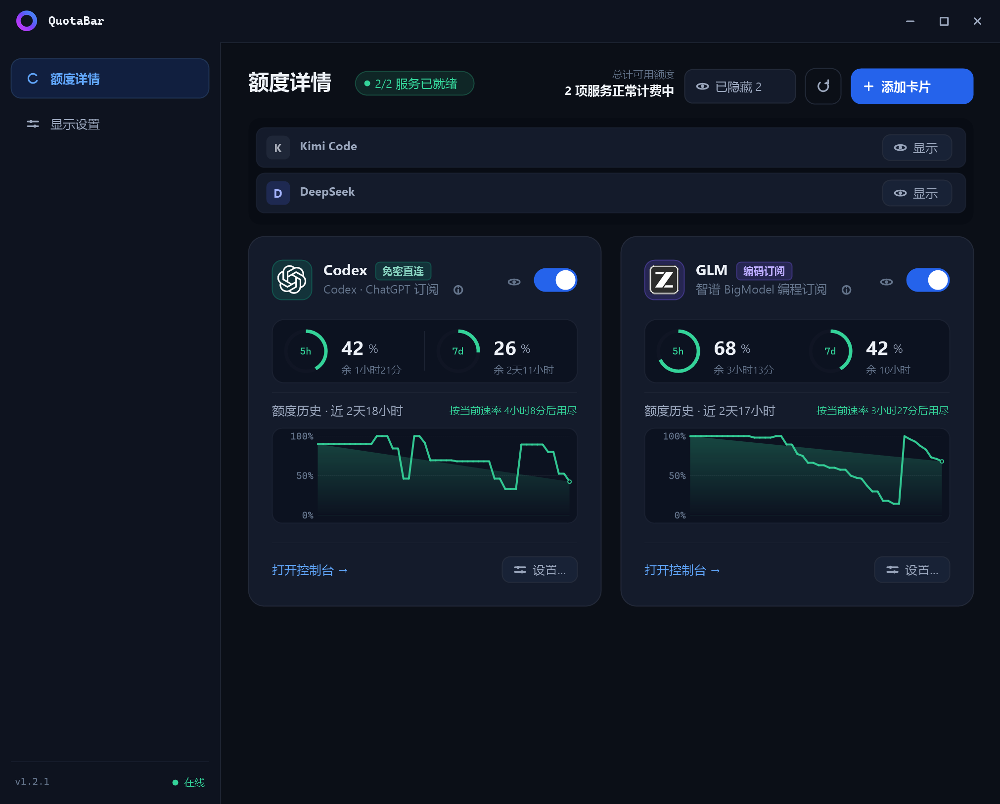
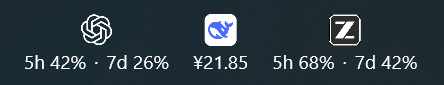
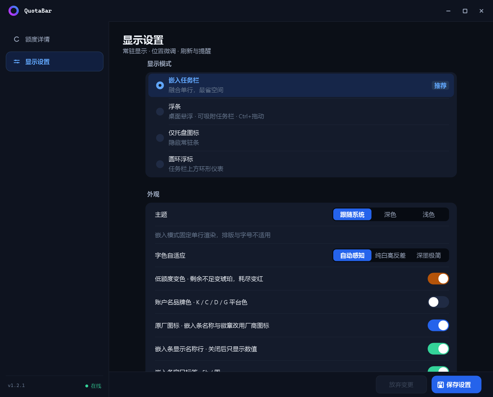

<div align="center">


# QuotaBar

**把 AI 编程额度钉在 Windows 11 任务栏上**

Kimi Code · Codex · GLM Coding Plan · DeepSeek · Antigravity —— 余额与用量一眼可见，不必打开任何控制台。

[](https://github.com/CorN0r/QuotaBar/releases/latest)


**[⬇ 下载最新版](https://github.com/CorN0r/QuotaBar/releases/latest)**



<sub>额度详情：每账户一张卡片 —— 额度仪表、到期倒计时、30 天趋势、预计用尽时间；点「设置 ▾」就地展开别名 / 密钥 / 阈值。</sub>



<sub>嵌入模式：融合进任务栏的两行小条（也可单行），原厂图标 + 双窗口额度。</sub>

</div>

## ✨ 特性

- **五类数据源**：Kimi Code 周期额度（5h 滚动 + 周窗）、Codex / ChatGPT 订阅（免密直连）、智谱 GLM Coding Plan（5h / 周 / 月度调用）、DeepSeek API 余额、**Antigravity 订阅额度**（经本机 Antigravity 免密直连，Gemini 池 5h / 周）—— 多账户各一张卡片，随时增删。
- **四种显示模式**：**嵌入任务栏**（推荐，融合单行/双行）/ **桌面浮条**（可吸附任务栏、按住 Ctrl 直接拖动）/ **圆环浮标** / 仅托盘。
- **用量洞察**：每账户滚动采样 30 天历史 —— 趋势折线 + 消耗速率 + **预计用尽时间** + 金额账户今日消耗。
- **低额预警**：Win11 Toast 通知（失败自动回落托盘气球）+ 逐账户阈值（继承全局 / 关闭 / 自定义档），额度重置后另有恢复提醒。
- **深浅双主题**：跟随系统 / 深色 / 浅色，即点即换；低额度值段自动变琥珀 / 红。
- **账户设置就地展开**：别名、API Key（掩码 + 复制）、预警阈值、启停显隐、拖拽排序 —— 全部在卡片上完成，即改即存。
- **原生 Win32**：单进程、单文件 exe（约 1 MB，静态 CRT，无运行时依赖）；高 DPI、全屏自动隐藏、Explorer 重启自恢复、开机自启可选。

<p align="center">
<br/>
<sub>显示设置：模式 / 外观 / 位置微调 / 刷新与提醒 / 启动与数据，全部即调即存。</sub>
</p>

## 🚀 快速开始

1. 从 [**Releases**](https://github.com/CorN0r/QuotaBar/releases/latest) 下载 `QuotaBar-vX.Y.Z-x64.zip`，解压直接运行 `QuotaBar.exe`（无需安装）。
2. 首次运行自动打开主窗口 —— 点「**添加卡片**」粘贴对应平台的 API Key 即建卡即查询；**Codex 免密**：先用 [Codex CLI](https://github.com/openai/codex) 登录一次即可；**Antigravity 免密**：启动 Antigravity 并登录 Google 账户即可，卡片经它的本机服务只读查询（Antigravity 未运行时显示「未运行」，启动后约一分钟内自动连接）。
3. 托盘左键开关主窗口，右键：立即刷新 / 显示设置 / 暂停查询 / 退出。

自检：`QuotaBar.exe --selftest`（339 项合成自测，不访问网络、不读写任何数据）。

## 🛠 从源码构建

```bat
build.bat                                              :: MSVC（VS2022 BuildTools），产出 build\QuotaBar.exe
cmake -B build-cmake -G "Visual Studio 17 2022" -A x64 :: 备选：CMake
python tools\make_release.py                           :: 构建 + 339 项自测门禁 + 打包 dist\QuotaBar-vX.Y.Z-x64.zip
```

> 源码均为 UTF-8；`build.bat` 须保持 GBK + CRLF（cmd 兼容），勿转码。

## 🔒 数据与隐私

- 全部数据只存本机 `%LOCALAPPDATA%\QuotaBar\`：`config.json`（设置，无密钥）、`secrets.dat`（**DPAPI 加密**，绑定当前 Windows 账户）、`cache.json` / `history.json`（快照与历史，无密钥）、`logs\`（脱敏日志）。
- **API Key 永不出本机**：DPAPI 加密存储，请求只发往对应平台官方端点；**Codex 令牌只读** `~/.codex/auth.json`，QuotaBar 不落盘、不复制；**Antigravity 不接触任何 Google 令牌**——只读本机 Antigravity 服务的连接描述文件（`~/.gemini/` 下的端口与本机访问令牌），额度查询发往 `127.0.0.1`，由 Antigravity 自己完成对 Google 的认证。
- 无遥测、无上传、无账号体系。清除数据：显示设置 →「清除数据」。

## 📋 已知限制

- Kimi 会员月度总池无 API Key 可达来源（仅网页 Cookie 可见），卡片固定显示「未获取」，不做估算。
- Antigravity 需在本机**安装、登录并保持运行**（额度经它的本机服务查询，关闭后卡片在下次刷新时转为「未运行」）；该通道是 Antigravity 的内部接口，随其版本升级可能变化（结构不兼容时卡片会提示「接口不支持或已变化」）。Claude / GPT 模型池的额度在卡片 ⓘ 注解里以文字给出，常驻条与圆环只显示 Gemini 池。
- 8 小时长稳压测尚未进行（短时采样数据见 [RELEASE-NOTES](RELEASE-NOTES.md)）。

## 📄 许可证

[MIT](LICENSE) · `assets/provider/` 内各厂商图标版权归原作者所有，仅用于标识对应服务。

面向维护者的工程笔记（架构约定、踩坑记录）见 [CLAUDE.md](CLAUDE.md)，版本历史见 [RELEASE-NOTES.md](RELEASE-NOTES.md)。
